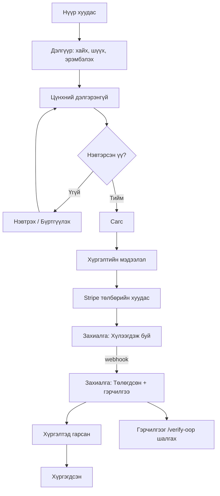
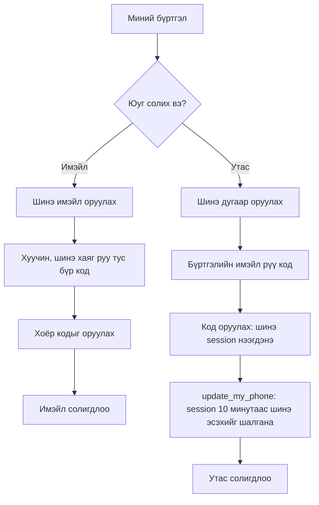
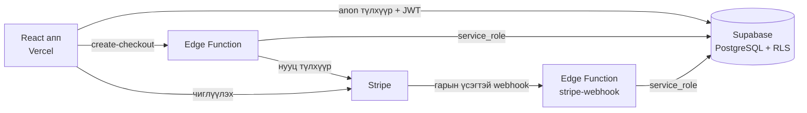
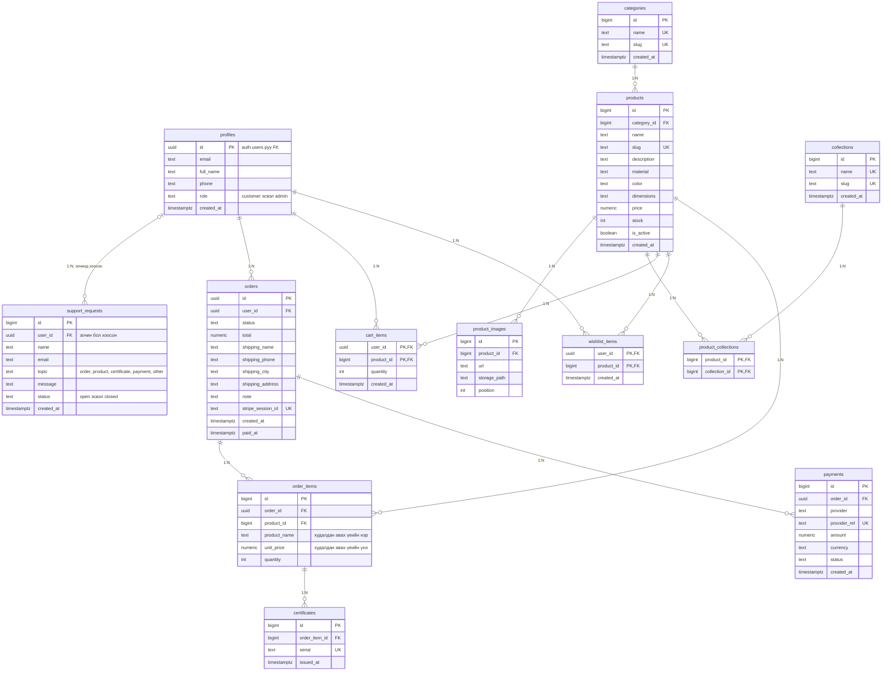
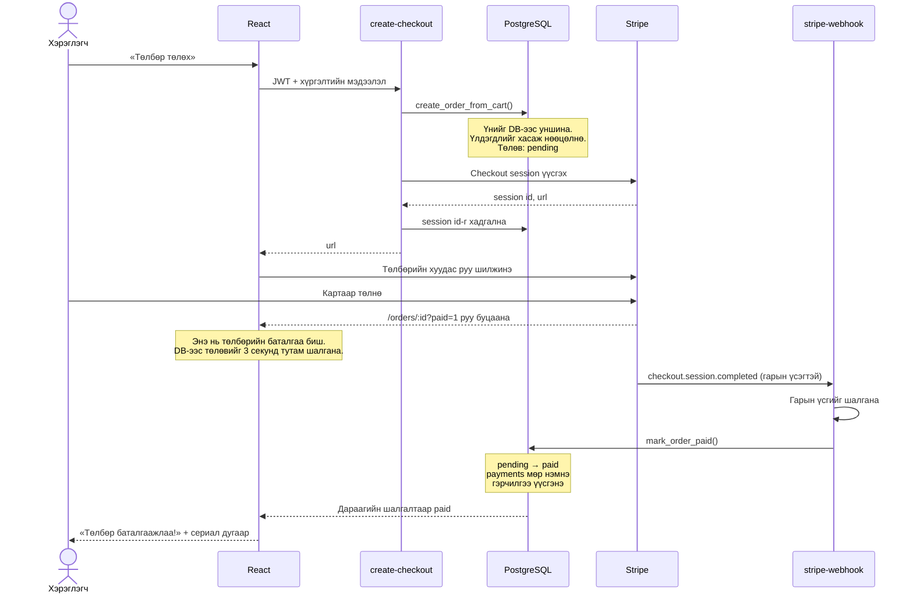
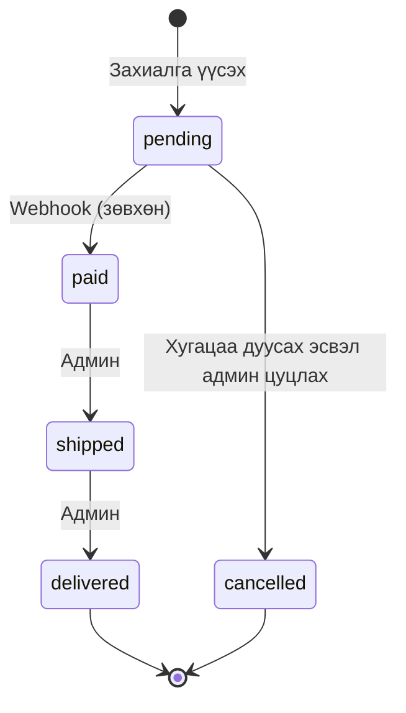

# Maison Erdene: шаардлага ба дизайн

## 1. Шийдэж буй асуудал

Монголд тансаг зэрэглэлийн цүнх худалдан авахад гурван бэрхшээл тулгардаг:

1. **Хуурамч бараа.** Худалдан авагч цүнх жинхэнэ эсэхийг өөрөө шалгах аргагүй.
2. **Онлайн суваг дутмаг.** Ихэнх худалдаа сошиал хуудсаар, гар аргаар явагддаг.
3. **Дахин худалдаанд итгэл алга.** Хоёр дахь эзэн цүнхний гарал үүслийг мэдэх боломжгүй.

**Шийдэл, бусдаас ялгарах зүйл:** зарагдсан цүнх бүрд сериал дугаартай цахим гэрчилгээ олгож, нийтэд нээлттэй `/verify` хуудсаар шалгуулна. Гэрчилгээ зөвхөн төлбөр баталгаажсаны дараа webhook-оор үүснэ, тиймээс хуурамчаар үүсгэх боломжгүй. Шалгах хуудас цүнхний мэдээллийг л харуулж, худалдан авагчийн хувийн мэдээллийг ил болгодоггүй.

## 2. Хэрэглэгчийн төрөл

| Эрх | Боломж |
|---|---|
| **Зочин** | Цүнх үзэх, хайх, шүүх, гэрчилгээ шалгах, тусламжийн хүсэлт илгээх |
| **Хэрэглэгч** | Дээрх бүгд + сагс, хадгалах, захиалах, төлбөр төлөх, захиалгын түүх, гэрчилгээ, өөрийн хүсэлтүүдийг харах, имэйл/утсаа кодоор баталгаажуулж солих |
| **Администратор** | Дээрх бүгд + бүтээгдэхүүн, ангилал, цуглуулга, захиалга, хэрэглэгч, төлбөр, статистик, тусламжийн хүсэлт |

## 3. Хэрэглэгчийн урсгал

**Тусламж:** зочин ч `/help` хуудсаас хүсэлт илгээнэ → админ «Тусламж» хэсгээс харж, имэйлээр хариулаад «Шийдвэрлэсэн» болгоно.

**Имэйл, утас солих:**

Код бүхий имэйлд мөн холбоос байдаг. Холбоосыг дарахад ч адилхан баталгаажна.

**Wireframe:** үндсэн хуудсуудын 13 хуудас бүхий wireframe: [wireframes/wireframes.pdf](wireframes/wireframes.pdf). Тусламжийн төв болон имэйл/утас солих дэлгэц нь wireframe-ийн дараа нэмэгдсэн.

## 4. Архитектур

## 5. ERD

13 хүснэгттэй. 1:N болон N:M холбоог хоёуланг нь ашигласан. Зураг хэлбэрээр: [erd.png](erd.png).

**N:M холбоо:** `products ↔ collections` (`product_collections`-оор), `profiles ↔ products` (`cart_items`, `wishlist_items`-ээр), `orders ↔ products` (`order_items`-ээр).

## 6. RLS бодлого

| Хүснэгт | Унших | Бичих |
|---|---|---|
| `categories`, `collections`, `product_images`, `product_collections` | Бүгд | Зөвхөн админ |
| `products` | Идэвхтэйг нь бүгд, нуугдсаныг зөвхөн админ | Зөвхөн админ |
| `profiles` | Өөрийнх эсвэл админ | Зөвхөн өөрийн нэр. Утсыг зөвхөн `update_my_phone()` функцээр, кодоор баталгаажуулсны дараа. `role` баганыг шууд өөрчлөх эрх хэнд ч алга |
| `support_requests` | Өөрийнх эсвэл админ (зочин уншиж чадахгүй) | Хэн ч өөрийн нэрээр илгээнэ, нэг имэйлээс цагт 5 хүртэл. Төлөвийг зөвхөн админ өөрчилнө |
| `cart_items`, `wishlist_items` | Өөрийнх | Өөрийнх |
| `orders`, `order_items`, `payments`, `certificates` | Өөрийнх эсвэл админ | Browser-оос бичих эрхгүй. Зөвхөн SQL функцээр |
| Storage `product-images` | Бүгд | Зөвхөн админ, 5 MB, JPG/PNG/WEBP |

Яагаад `orders` руу шууд бичиж болдоггүй вэ? Хэрэв боломжтой бол хэрэглэгч browser-ийн консолоос `status = 'paid'` болгож, үнэгүй цүнх авах байсан.

## 7. Төлбөрийн урсгал

### Онцгой тохиолдлууд

| Тохиолдол | Шийдэл |
|---|---|
| Сүүлийн цүнхийг хоёр хүн зэрэг захиалах | `FOR UPDATE` мөрийг түгжинэ. Нэг нь амжилттай, нөгөө нь «үлдэгдэл хүрэлцэхгүй» мэдэгдэл авна |
| Төлбөр төлөхгүй орхих | Session 31 минутын дараа дуусч, webhook захиалгыг цуцлан үлдэгдэл болон сагсыг сэргээнэ |
| Stripe ажиллахгүй байх | Захиалга цуцлагдаж, үлдэгдэл болон сагс сэргээгдэнэ |
| Stripe нэг webhook-ийг хоёр удаа илгээх | Төлөв аль хэдийн paid бол `already_paid` буцаана. Давхар төлбөр, гэрчилгээ үүсэхгүй |
| Хуурамч webhook | Гарын үсэг таарахгүй бол 400, юу ч өөрчлөгдөхгүй |
| Цуцлагдсан захиалгад төлбөр орох | `needs_refund` төлөвтэй бүртгэгдэж, админы «Төлбөр» хуудсанд харагдана. Буцаалтыг Stripe дээр гараар хийнэ |
| Webhook түр алдаа | 500 буцааж, Stripe дахин илгээнэ. SQL функцууд давтахад аюулгүй |

## 8. Захиалгын төлөв

## 9. Дизайн систем

| Зүйл | Сонголт |
|---|---|
| Хэв шинж | «Чимээгүй тансаг»: цагаан дэвсгэр, том кампанит зураг, бичлэг, дөрвөлжин ирмэг. Нүүр хуудас нь загварын ордны цуглуулгын хуудас шиг: бүтээгдэхүүний тор дунд том зураг орно |
| Өнгө | Цагаан `#ffffff`, элсэн саарал `#f6f5f3`, бэх хар `#19110b`, алт `#b08d57` |
| Гарчиг | Manrope, нимгэн жин. Брэндийн нэр ERDENE нь Cormorant Garamond |
| Эх бичвэр | Manrope (кирилл үсэгтэй) |

Бүх утгыг `src/index.css` доторх `@theme` хэсэгт нэг дор тодорхойлсон.

## 10. Эх сурвалж ба зөвшөөрөл

- Цүнхний зураг, кампанит бичлэг (`public/media`): Google Gemini-ээр үүсгэсэн, лого, бичиггүй.
- Зураггүй цүнхний зураг: энэ төсөлд `scripts/generate-bag-art.mjs` скриптээр зурсан анхны зураг.
- Фонтууд: Cormorant Garamond, Manrope (SIL Open Font License, Fontsource-оор).
- Брэндийн нэр, лого: зохиомол. Бодит тансаг брэндийн лого, зураг, загвар ашиглаагүй.
